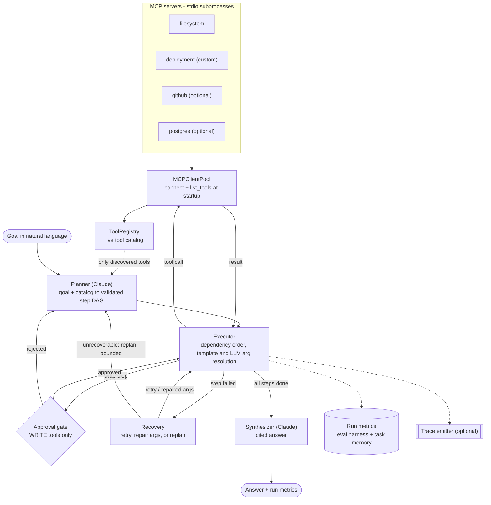

# Switchboard

**A multi-server MCP agent orchestrator built on the Anthropic API.** Give it a goal in plain
English. It connects to several [MCP](https://modelcontextprotocol.io) servers, discovers their
tools at runtime, has Claude plan a dependency-ordered execution graph, runs it with retry /
argument-repair / replan on failure, pauses for human approval before any write action, and
returns a cited answer along with per-run metrics.

Most agent demos hardcode a toolset and loop. Switchboard is the *client-side* harness around the
model: planning, passing data between tool calls, recovering from failures, gating risky actions,
and measuring runs. The included demo task is cross-system incident triage (deployments, logs,
service health, file notes, and a gated rollback).

> **Status.** The harness is verified offline: 21 unit/integration tests, plus the
> [replay below](#sample-run) running real MCP servers end to end. Results from a live-model run
> and a live-model eval batch have **not** been published yet; see
> [Evaluation harness](#evaluation-harness) and [Known limitations](#known-limitations).

## Architecture



1. **Discovery.** At startup `MCPClientPool` launches every enabled server in
   [config/servers.yaml](config/servers.yaml) and calls `list_tools`. The planner only ever sees that
   live catalog; adding a server adds capabilities with no code change.
2. **Plan.** Claude returns a step DAG (`server.tool`, arguments, `depends_on`). It is validated
   against the catalog before anything runs.
3. **Execute.** Steps run in dependency order. Later steps reference earlier results with
   `{{steps.1.output.id}}`, or ask the model to fill arguments from live observations.
4. **Guard and recover.** WRITE tools stop at a human approval gate. Failures are retried with
   backoff, repaired by the model, or escalated to a bounded replan.
5. **Answer.** Claude synthesizes a cited answer; every run records metrics and (optionally) a trace.

## Key features

| Feature | Where | Status |
|---|---|---|
| Runtime tool discovery across servers | [mcp_client.py](src/orchestrator/mcp_client.py), [registry.py](src/orchestrator/registry.py) | Verified with 2 servers (filesystem + custom). GitHub and Postgres are configured but disabled and untested here. |
| Planner returns a validated DAG | [planner.py](src/orchestrator/planner.py) | Unknown tools and missing/self dependencies are rejected. Cycles and duplicate ids are **not** (see limitations). |
| Dependency-ordered execution | [executor.py](src/orchestrator/executor.py) | Sequential topological order. No parallel execution. |
| Data flow between steps | [templating.py](src/orchestrator/templating.py) | `{{steps.N.output.path}}` templating (tested). LLM runtime argument resolution (tested with a scripted model only). |
| Failure recovery | [recovery.py](src/orchestrator/recovery.py) | Transient errors: backoff retry. Bad arguments: one LLM repair. Otherwise: bounded replan (`max_replans`, `max_step_attempts`). Tested offline. |
| Human-in-the-loop approval | [approval.py](src/orchestrator/approval.py) | Tools listed under `write_tools` in the config are gated. CLI prompt, or `--approve auto\|reject`. Each decision records who approved. |
| Task memory | [memory.py](src/orchestrator/memory.py) | Successful tool sequences saved to `data/memory.json`; similar past goals (keyword overlap) are fed to the planner as hints. |
| Evaluation harness | [evaluation.py](src/orchestrator/evaluation.py) | Per-run and aggregate metrics (see below). Measures completion, not answer correctness. |
| Tracing | [tracing.py](src/orchestrator/tracing.py), [switchboard-trace/](switchboard-trace) | Optional, no-op by default; never changes agent behavior. The collector/UI is a separate project and not in this repo. |
| Custom MCP server | [servers/deployment_server.py](servers/deployment_server.py) | Fake deploy control plane: deployments, health, logs, and a WRITE `rollback_deployment`. |

**Not implemented:** parallel step execution, answer-correctness scoring or golden tasks,
semantic (embedding) memory, token streaming.

## Quickstart

Requires **Python 3.10+** and **Node.js** (the filesystem server runs via `npx`; the first launch
downloads it).

```bash
git clone https://github.com/71ashu/mcp-agent-orchestrator.git
cd mcp-agent-orchestrator
python3 -m venv .venv && source .venv/bin/activate
pip install -e ".[dev]"
cp .env.example .env          # set ANTHROPIC_API_KEY (needed for `run` / `eval` only)
```

Works with **no API key**:

```bash
orchestrator servers               # connect to the MCP servers and list every discovered tool
python examples/offline_demo.py    # full run with a scripted model, real servers (see below)
pytest                             # 21 tests, offline
```

Needs `ANTHROPIC_API_KEY` in `.env`:

```bash
orchestrator run "Find the latest production deployment for payments, inspect its logs, and tell me whether it introduced a problem."
orchestrator run "Roll back the bad payments deployment"            # asks before the write step
orchestrator run "..." --approve reject --json                      # auto-reject writes, machine-readable
orchestrator memory                                                 # show recorded task memory
```

Run commands from the repo root (config and `sandbox/` paths are relative). Set the model with
`ORCHESTRATOR_MODEL` (default `claude-sonnet-5`). To add servers, set `enabled: true` for `github`
or `postgres` in [config/servers.yaml](config/servers.yaml) and fill in the matching variables from
`.env.example`.

## Sample run

> **Offline replay, not a live-model run.** The MCP servers, tool calls, results, dependency
> ordering, templating and approval gate are real. The plan and final answer are *scripted* replies
> passed through the real `LLM` class, so this demonstrates the harness, not model quality.
> Reproduce it with `python examples/offline_demo.py` ([source](examples/offline_demo.py)).

**Goal:** *Find the latest production deployment for payments, inspect its error logs and the
service health, check who owns the service, and if it is clearly bad, roll it back.*

```text
 #  server.tool                       depends  rationale
 1  deployment.get_latest_deployment  -        identify the live deployment
 2  deployment.get_logs               1        error logs for that deployment
 3  deployment.get_service_health     -        current error rate and latency
 4  filesystem.read_text_file         -        who owns the payments service
 5  deployment.rollback_deployment    2,3      WRITE: restore the previous deployment

● step 1  deployment.get_latest_deployment  succeeded 4ms
● step 3  deployment.get_service_health     succeeded 2ms      <- independent steps first,
● step 4  filesystem.read_text_file         succeeded 6ms         then dependents
● step 2  deployment.get_logs               succeeded 3ms      <- {{steps.1.output.id}} resolved
● step 5  deployment.rollback_deployment    awaiting_approval
╭──── Approval required — deployment.rollback_deployment ────╮
│ { "deployment_id": "d-payments-482",                        │
│   "reason": "5xx rate 6.1% and p95 910ms after rollout" }   │
╰─────────────────── scripted approver: approving ───────────╯
● step 5  deployment.rollback_deployment    succeeded 2ms

Tool results (real, truncated):
  step 1 deployment.get_latest_deployment: {"id": "d-payments-482", "service": "payment…
  step 3 deployment.get_service_health: {"service": "payments", "status": "degraded"…
  step 4 filesystem.read_text_file: "payments service — owns capture, refun…
  step 5 deployment.rollback_deployment: {"rolled_back": "d-payments-482", "restored"…

Answer (scripted): The live payments deployment d-payments-482 is unhealthy: error rate
0.4% -> 6.1% and p95 240ms -> 910ms, with a NullPointerException in RefundService.settle and
ledger timeouts. Owner: #payments-oncall. It was rolled back to d-payments-481 after approval.

steps=5 tool_calls=5 failures=0 retries=0 replans=0 approvals=1/1
```

The excerpt trims the planner-reasoning panel, the step-2 result line and the server startup logs.

## Evaluation harness

```bash
orchestrator eval examples/eval_tasks.txt            # one goal per line, '#' lines ignored
orchestrator eval examples/eval_tasks.txt --approve reject    # default is auto-approve
```

Needs `ANTHROPIC_API_KEY`. It runs each goal through the full loop and prints one row per run:

| Column | Meaning |
|---|---|
| `ok` | The run finished without an unrecoverable failure. **It is not an answer-correctness check.** |
| `steps` / `calls` / `fail` | Planned steps, tool calls made, tool calls that errored |
| `retry` / `replan` | Recovery actions taken |
| `wall(ms)` | End-to-end latency |
| `tok(in/out)` / `$` | Model tokens, and cost estimated at a flat $3 / $15 per million input/output tokens (edit `estimated_cost_usd` in [models.py](src/orchestrator/models.py) to match your pricing) |

It then prints an aggregate JSON summary: `runs`, `success_rate`, `avg_steps`, `avg_tool_calls`,
`total_tool_failures`, `total_retries`, `total_replans`, `avg_wall_ms`, `total_cost_usd`.

**Example results: none published yet.** The harness is covered by offline tests; a first
live-model batch over [examples/eval_tasks.txt](examples/eval_tasks.txt) is pending and will be added
here. `eval` auto-approves WRITE tools by default, which is safe against the in-memory demo server
but worth knowing before pointing it at real servers.

## Tracing (optional)

Runs can stream OpenTelemetry-style spans to a collector. It is off unless `SWITCHBOARD_TRACE_URL`
is set, and it never alters agent behavior. If the collector is down, events are buffered, retried,
and eventually dropped with a warning. The collector and UI ("Agent Trace Explorer") are a separate
project and not in this repo; the emitter works standalone.

```bash
pip install -e ./switchboard-trace            # not on PyPI
export SWITCHBOARD_TRACE_URL=http://localhost:4100
export SWITCHBOARD_TRACE_TOKEN=...            # if the collector requires one
orchestrator run "..."
```

```text
run
├─ plan #1 ─ llm:plan
├─ step 1: deployment.get_latest_deployment ─ tool_call (attempt 1)
├─ step 2: …  (depends_on → step 1)
│   ├─ llm:resolve_args
│   ├─ approval            (approver, decision, wait_ms)
│   ├─ tool_call (attempt 1) ✗
│   ├─ retry               (action: retry | repair_args | replan | abort) ─ llm:repair_args
│   └─ tool_call (attempt 2) ✓
├─ replan #2 …             (after a rejection or unrecoverable failure)
├─ llm:synthesize
└─ eval                    (only under `orchestrator eval`; tagged with eval_batch_id)
```

Emitter details (guarantees, secret redaction, event schema) are in
[switchboard-trace/README.md](switchboard-trace/README.md).

## TypeScript port

A TypeScript port lives on the **`typescript-port`** branch, under
[`ts/`](https://github.com/71ashu/mcp-agent-orchestrator/tree/typescript-port/ts). It is not merged
into the default branch.

- **Stack:** the official `@modelcontextprotocol/sdk` and `@anthropic-ai/sdk`, with `zod` validating
  every model-produced plan before it executes.
- **Verified:** typecheck is clean, 28/28 tests pass (offline, including an end-to-end run against
  the TS deployment server), and `servers` connects to both servers from a fresh clone. The live
  model path has not been run.
- **Differs from this Python version:** it was ported from the earlier scaffold, so it has **no
  tracing and no approval-decision records**. It is *ahead* on two points: zod plan validation with
  duplicate-id rejection, and replans that receive the observations from steps that already
  succeeded.

```bash
git checkout typescript-port && cd ts
npm install && mkdir -p sandbox && npm test
```

## Known limitations

- **Plan validation is partial.** A cyclic plan raises a bare `ValueError` mid-run that the replan
  loop does not catch, and duplicate step ids are accepted.
- **Replans lose observations.** The failure reason is passed to the planner, but "observations so
  far" is always empty, because step outputs are not returned when the executor raises. (Fixed in the
  TS port.)
- **Recovery is shallow.** One LLM argument repair, then a bounded replan. There is no persistent
  reflection memory.
- **Memory is keyword-based**, not semantic.
- **Execution is sequential**, even for independent steps.
- **Live-model results are pending.** Everything LLM-dependent is tested with scripted models; the
  Anthropic SDK request shape is checked against the installed SDK signature in the test suite.

## Repo layout

| Path | Role |
|---|---|
| `src/orchestrator/` | The harness: `mcp_client`, `registry`, `planner`, `executor`, `recovery`, `approval`, `orchestrator`, `memory`, `evaluation`, `tracing`, `cli` |
| `servers/deployment_server.py` | Custom MCP server used by the demo |
| `config/servers.yaml` | Server registry and which tools are WRITE |
| `sandbox/` | Seed files for the filesystem server (anything the agent writes here is git-ignored) |
| `examples/` | `offline_demo.py`, `eval_tasks.txt`, `tasks.md` (example goals) |
| `switchboard-trace/` | Standalone trace emitter package, with its own tests |
| `tests/` | 21 offline tests (`pytest`) |

The trace emitter has its own suite (32 tests): `cd switchboard-trace && pytest`.
